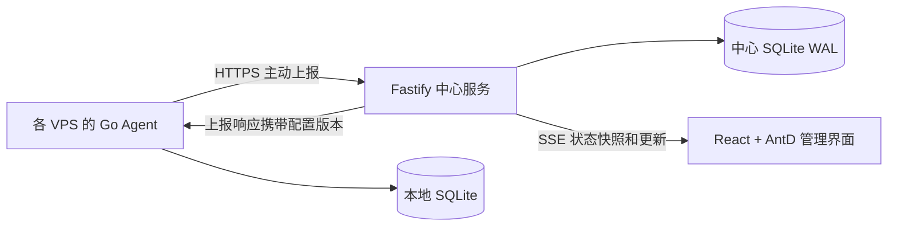

# 多 VPS 监控后台升级方案（Go Agent 版）

## 目标

将现有单机流量监控升级为集中管理 1～50 台 Linux VPS 的后台。前端使用 React、TypeScript、Ant Design 6、Vite；中心使用 TypeScript、Fastify、SQLite；Agent 使用 Go、本地 SQLite、HTTPS 主动上报。提供单管理员登录，资源分钟数据保留 30 天，流量历史长期保存。首版不包含告警通知、多用户权限、进程和 Docker 管理。

## 架构

- `apps/web`：React Router、TanStack Query、ECharts，深色/浅色主题，响应式布局。
- `apps/api`：登录、节点、采集接收、统计查询、SSE，better-sqlite3 持久化及版本化迁移。
- `packages/contracts`：JSON Schema 与 TypeScript 类型、协议样例；Go 通过契约测试核对。
- `agent`：采集、流量统计、存储、上报和迁移分层。gopsutil 采集资源，直接读取 Linux 网卡计数器。modernc.org/sqlite 提供无 CGO 数据库驱动，内嵌 time/tzdata。

中心通过 Docker Compose 部署，提供前端和 API，经 HTTPS 反向代理访问；Agent 使用 systemd 原生运行，发布 Linux amd64、arm64 独立程序，无需安装语言运行环境，无需新增入站端口。

## 页面和功能

| 页面 | 内容 |
| --- | --- |
| 登录 | 单管理员登录、错误提示、会话过期 |
| 总览 | 在线节点、总上下行速率、资源排行、异常节点 |
| VPS 列表 | 搜索、分组、标签、状态筛选、排序分页、停用归档 |
| VPS 详情 | 独立路由，系统信息、CPU/内存/负载/网络曲线、磁盘、周期与累计流量 |
| 节点接入 | 创建节点、仅显示一次的独立凭据、安装配置、接入验证 |
| 设置 | 节点资料、网卡、周期、管理员密码 |

默认中文深色主题，可切换浅色。移动端折叠导航、卡片列表。趋势支持 1/6/24 小时、7/30 天；长范围按小时聚合。区分未接入、在线、数据陈旧、离线、停用、归档。离线保留最后数据，缺失指标显示为空缺。

采集 CPU、核心数、内存、Swap、1/5/15 分钟负载、持久文件系统容量、网络速率、主机名、系统版本、架构、运行时长；排除伪文件系统、容器叠加挂载。

## 采集与一致性

1. 网络每秒采样，资源及实时上报每 5 秒执行。采集不等待 HTTP 请求。
2. 资源按 UTC 分钟保存平均值、最大值、样本数；资源数据两端均清理至 30 天，流量分钟记录、累计值长期保留。
3. 中心以接收时间判断状态：超过 15 秒陈旧，超过 45 秒离线。陈旧节点速率不计入实时总速率。
4. Agent 持久化稳定源 ID、单调修订号、记录和同步游标。上报绝对值，通过主键及修订号幂等更新；事务提交后才确认。确认丢失可重发；乱序旧值不得覆盖新值。
5. 每次发送最新快照和有界历史批次。资源和流量独立同步游标，避免长期流量回填阻塞近期资源。补传不回滚最新快照。
6. 配置由中心按版本管理，响应中下发；Agent 校验并持久化后确认，失败沿用原配置并上报错误。首次迁移将旧配置带到新节点，之后中心为配置来源。
7. 保留计数器归零、系统重启、首次采样、网卡切换、离线补记规则，补记不伪装成实时速率。月周期按 IANA 时区及日历月计算，短月夹取最后一天。
8. 中心按流量分钟记录重算当前及上一周期，累计值由每网卡累计记录汇总；跨节点总览注明“各节点自身周期之和”。停机跨月无法精确分摊的原有限制继续存在。

字节累计在 SQLite 中用 64 位整数保存，JSON 用十进制字符串；速率和百分比用数值。时间统一 UTC。无样本和真实零值不同，图表不把断网补成零。

## API 与安全

统一 `/api/v1`：`/auth` 登录/退出/会话/密码；`/nodes` 节点管理；`/nodes/:id/config` 配置；`/nodes/:id/history` 历史；`/overview` 总览；`/events` SSE；`/agent/report` 上报。

协议版本固定为 1，JSON Schema 校验，未知版本拒绝。浏览器使用同源 HttpOnly 会话 Cookie，写操作校验 CSRF 与 Origin；密码使用 scrypt。登录限流；会话过期时关闭 SSE。每节点独立随机凭据，中心仅保存摘要；凭据只在创建时返回。Agent 配置权限 0600，日志不打印凭据及上报头。HTTPS 验证系统证书，仅本机开发允许 HTTP。

## 迁移与回退

提供显式 `migrate` 命令，默认只读预览，`--apply` 才创建新目录。正式迁移前停止旧采集服务；只读打开源数据库并使用 SQLite 一致性快照，保留原数据库/配置；复制到新的 Agent 目录再添加新表及同步标记。拒绝非空目标，避免覆盖。迁移后确认累计、当前周期、上一周期，首次接入分批导入历史，可安全重试。

项目仅维护 TypeScript 中心和 Go Agent，保留旧库迁移能力；旧版入口、静态网页及部署文件已移除。如需回退，应在迁移前另行保存旧版本程序和部署配置。不让两个采集进程写同一份库，不修改现有 `trafficmon` 数据。

## 实施与验收

顺序：方案落档 → 共享协议与中心 → Go Agent → React 后台 → 集成与迁移验收。

- Go 覆盖日历周期、闰年、31 日、时区、重启、归零、网卡切换、迁移。
- 中心覆盖鉴权、CSRF、节点隔离、重复/乱序/确认丢失、事务回滚、配置应用和数据保留。
- Go HTTP 测试覆盖断网/重试、确认后推进游标、重启恢复、配置失败。
- 浏览器覆盖登录、筛选、详情直达刷新、SSE 重连、离线、主题、1440/768/390px。
- 50 个模拟 Agent 每 5 秒上报，检查写入/查询/SSE/清理；中心配合两个独立真实 Agent 做本地集成。
- TypeScript 检查、前端构建、Go 测试、amd64/arm64 交叉编译。交叉编译不等于真实 arm64 或实际 VPS 验证。

运行步骤、命令与已验证结果参见 `operations.md` 和 `verification.md`。
